<a href="README.md">Home</a> &nbsp;·&nbsp; <a href="docs/FEATURES.md">Features</a> &nbsp;·&nbsp; <a href="docs/FAQ.md">FAQ</a> &nbsp;·&nbsp; <a href="docs/PERMISSIONS.md">Permissions</a> &nbsp;·&nbsp; <a href="PRIVACY.md">Privacy</a> &nbsp;·&nbsp; <a href="docs/ARCHITECTURE.md">Architecture</a> &nbsp;·&nbsp; <a href="CHANGELOG.md">Changelog</a> &nbsp;·&nbsp; <a href="SECURITY.md">Security</a>

All notable changes are listed here. The format follows [Keep a Changelog](https://keepachangelog.com/en/1.1.0/) and versions follow [Semantic Versioning](https://semver.org/).

## [Unreleased]

### Added

- Build & Release workflow that builds a signed APK and publishes the APK to GitHub Releases and GitHub Packages (no stored Actions artifacts)
- Animated README, project documentation and community files
- `scripts/` helpers for fonts, versioning, signing and packaging

### Changed

- The app is now called Battery Stats everywhere (docs, release names, in-app text)
- Release workflow runs only on a version tag or by hand, and can pick the next version automatically
- `versionName` and `versionCode` can be supplied by Gradle properties `appVersionName` and `appVersionCode`

## [1.0.0]

### Added

- Live Monitor, Home dashboard, Statistics, Usage, Battery Health, Battery Checkup, Speed Test and History screens
- Charging speed classification and time-remaining estimates
- Session history, session comparison and per-app daily limits
- Always-on monitoring service, alerts, stop-charging reminder and lock-screen Charging Display
- Four Glance home-screen widgets
- CSV, PDF and SVG export

