<a href="README.md">Home</a> &nbsp;·&nbsp; <a href="docs/FEATURES.md">Features</a> &nbsp;·&nbsp; <a href="docs/FAQ.md">FAQ</a> &nbsp;·&nbsp; <a href="docs/PERMISSIONS.md">Permissions</a> &nbsp;·&nbsp; <a href="PRIVACY.md">Privacy</a> &nbsp;·&nbsp; <a href="docs/ARCHITECTURE.md">Architecture</a> &nbsp;·&nbsp; <a href="CHANGELOG.md">Changelog</a> &nbsp;·&nbsp; <a href="SECURITY.md">Security</a>

This project is for people who care about batteries, charging and well-made Android apps. Everyone taking part is expected to keep it welcoming.

## Expected

- Be respectful and patient, especially with newcomers
- Give feedback on the work, not the person
- Assume good intent and ask when something is unclear

## Not acceptable

- Harassment, insults or personal attacks
- Discriminatory language or imagery
- Publishing someone's private information
- Spam, advertising or repeated off-topic posts

## Enforcement

Maintainers may edit or remove comments, issues and pull requests, and may block people who break these rules. To report a problem, email yash92726@gmail.com.

