<a href="README.md">Home</a> &nbsp;·&nbsp; <a href="docs/FEATURES.md">Features</a> &nbsp;·&nbsp; <a href="docs/FAQ.md">FAQ</a> &nbsp;·&nbsp; <a href="docs/PERMISSIONS.md">Permissions</a> &nbsp;·&nbsp; <a href="PRIVACY.md">Privacy</a> &nbsp;·&nbsp; <a href="docs/ARCHITECTURE.md">Architecture</a> &nbsp;·&nbsp; <a href="CHANGELOG.md">Changelog</a> &nbsp;·&nbsp; <a href="SECURITY.md">Security</a>

Thanks for your interest in Battery Stats. The app's source code is private, so this repository holds the documentation, artwork and the release downloads. Feedback is still the most useful thing you can send.

## Ways to help

| | |
|---|---|
| 🐞 **Report a bug** | Open an issue with the *Bug report* template |
| 💡 **Suggest a feature** | Open an issue with the *Feature request* template |
| 🔒 **Security problem** | Do not post it publicly, see [`SECURITY.md`](SECURITY.md) |
| ❓ **A question** | Check the [FAQ](docs/FAQ.md) first, then open an issue |

## Bug reports that get fixed fast

> [!TIP]
> Include your phone model, Android version, app version, what you expected, what happened, and screenshots. For wrong charging numbers, say which charger and cable you used.

## Conduct

Be respectful. See [`CODE_OF_CONDUCT.md`](CODE_OF_CONDUCT.md).

