<a href="README.md">Home</a> &nbsp;·&nbsp; <a href="docs/FEATURES.md">Features</a> &nbsp;·&nbsp; <a href="docs/FAQ.md">FAQ</a> &nbsp;·&nbsp; <a href="docs/PERMISSIONS.md">Permissions</a> &nbsp;·&nbsp; <a href="PRIVACY.md">Privacy</a> &nbsp;·&nbsp; <a href="docs/ARCHITECTURE.md">Architecture</a> &nbsp;·&nbsp; <a href="CHANGELOG.md">Changelog</a> &nbsp;·&nbsp; <a href="SECURITY.md">Security</a>

Battery Stats is built on the open-source components below. Each keeps its own license, which applies to that component only. The [`LICENSE`](LICENSE) of this repository covers the Battery Stats code and assets, not these libraries.

| Component | License |
|---|---|
| Kotlin, kotlinx.coroutines, kotlinx.serialization, kotlinx.datetime | Apache License 2.0 |
| AndroidX (Core, Lifecycle, Activity, Navigation, Room, DataStore, WorkManager, Splash Screen) | Apache License 2.0 |
| Jetpack Compose and Material 3 | Apache License 2.0 |
| Jetpack Glance | Apache License 2.0 |
| Hilt and Dagger | Apache License 2.0 |
| Accompanist Permissions | Apache License 2.0 |
| iText 7 Core | GNU AGPL v3, or a commercial license from iText |
| JetBrains Mono (font, downloaded at build time) | SIL Open Font License 1.1 |
| Inter (font, downloaded at build time) | SIL Open Font License 1.1 |

## iText 7 Core

The PDF export uses iText 7 Core, which is offered under the AGPL v3 or a commercial license. If you distribute an application that includes it, review the AGPL source-availability obligations or obtain a commercial license from iText.

Check each project's repository for the full license text and current terms.

