<div align="center">



<br/>

[](../../releases/latest/download/batterystats.apk)
[](../../releases/latest)


**[Download](#-download)** &nbsp;·&nbsp; **[Offline & private](#-works-in-airplane-mode)** &nbsp;·&nbsp; **[Screenshots](#-screenshots)** &nbsp;·&nbsp; **[Features](#-features)** &nbsp;·&nbsp; **[How it works](#-how-it-works)** &nbsp;·&nbsp; **[Verify](#-verify-it-yourself)** &nbsp;·&nbsp; **[Docs](#-documentation)**

</div>


## ⚡ Overview

**Battery Stats** is a real-time charging and battery analyzer for Android. It reads the real values your phone reports, voltage, current, wattage, temperature and battery level, and turns them into live gauges, charging-speed classification, time estimates, session history, battery checkups and per-app usage stats.

Everything stays on your device. The app does not declare the `INTERNET` permission, so it has no way to send your data anywhere.

| | |
|---|---|
| **Package** | `com.yash.chargemeterpro` |
| **Minimum Android** | 8.0 (API 26) |
| **Target / compile SDK** | 35 |
| **UI** | Jetpack Compose, Material 3, custom "instrument panel" theme |
| **Language** | Kotlin 2.0.21 |


## 🛰 Works in airplane mode

<div align="center">
</div>

<br/>

Battery Stats never asks Android for the `INTERNET` permission, so it **cannot** open a network connection. There is nothing to switch off, nothing to opt out of and nothing to trust.

| | What that means for you |
|---|---|
| ✈️ **Fully offline** | Every screen, graph, export and widget works with Wi-Fi and mobile data off |
| 🔒 **Private by design** | Sessions and settings live in a database on your phone, nowhere else |
| 🚫 **No tracking** | No accounts, no ads, no analytics, no crash-reporting service |
| 🧾 **Honest numbers** | Values your phone does not report are shown as *not available*, never guessed |

> [!TIP]
> Don't take our word for it. Jump to **[Verify it yourself](#-verify-it-yourself)** for five checks you can run in minutes.


## 📱 Screenshots

<table>
<tr>
<td width="42%" align="center">
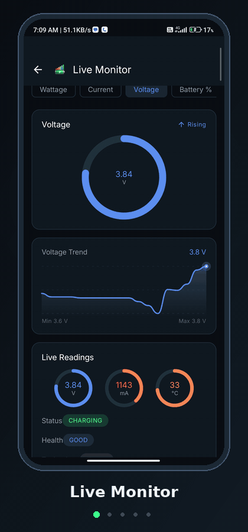
</td>
<td width="58%">

The app uses a dark "precision instrument" look: phosphor green for power, blue for voltage, orange for current and temperature.

**What you are seeing**

- **Live Monitor**: ring gauge, trend line with min/max, and live V / mA / °C readings
- **Home**: charging state, speed class, time remaining and power gauges
- **Usage**: total screen time, unlocks and per-app breakdown
- **Battery Checkup**: a step-by-step diagnostic run
- **Statistics**: today, all-time and 7-day drain figures

</td>
</tr>
</table>

<div align="center">
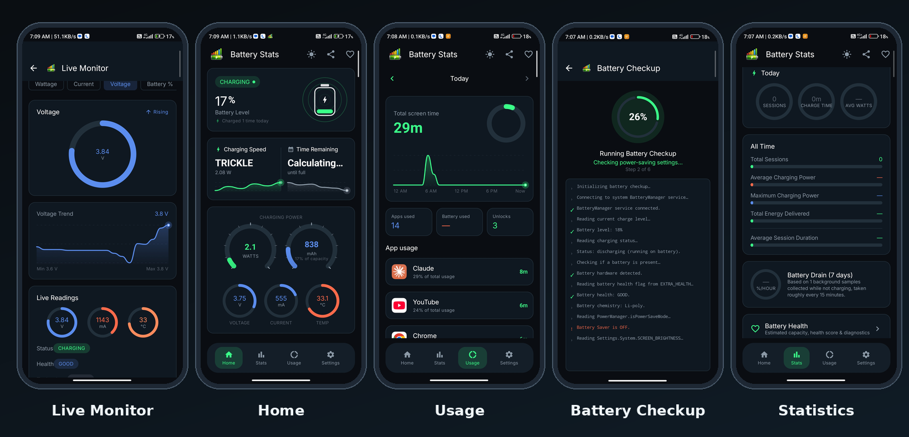
</div>

<details>
<summary><b>Individual screenshots</b></summary>
<br/>

| Home | Live Monitor | Usage | Checkup | Statistics |
|:---:|:---:|:---:|:---:|:---:|
| 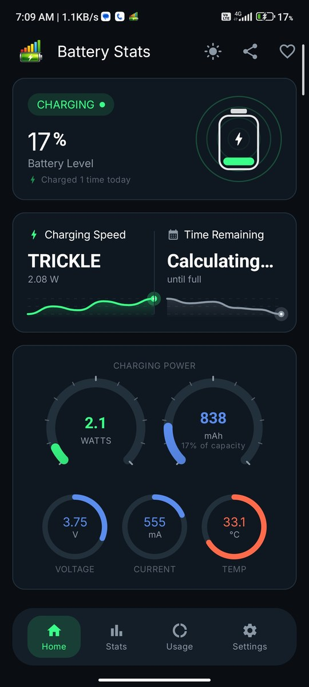 | 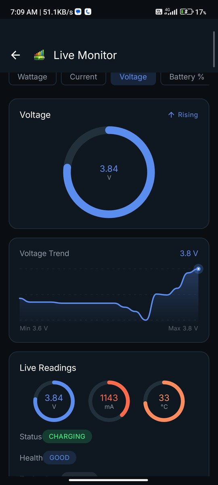 | 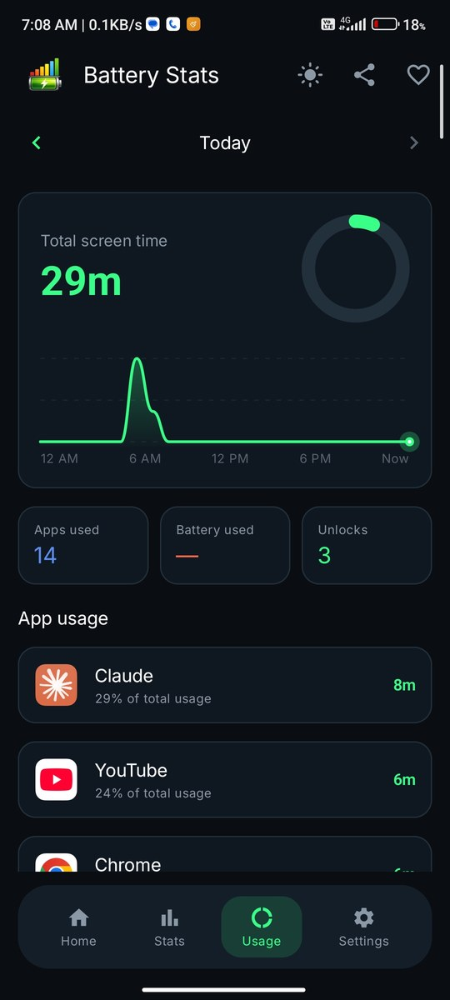 | 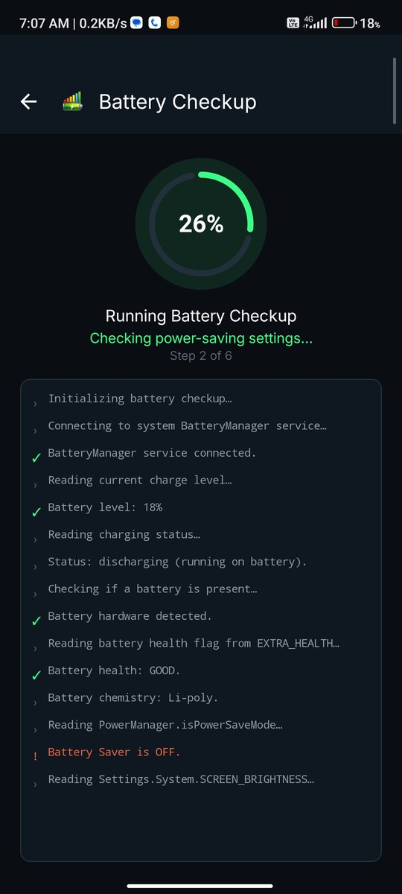 | 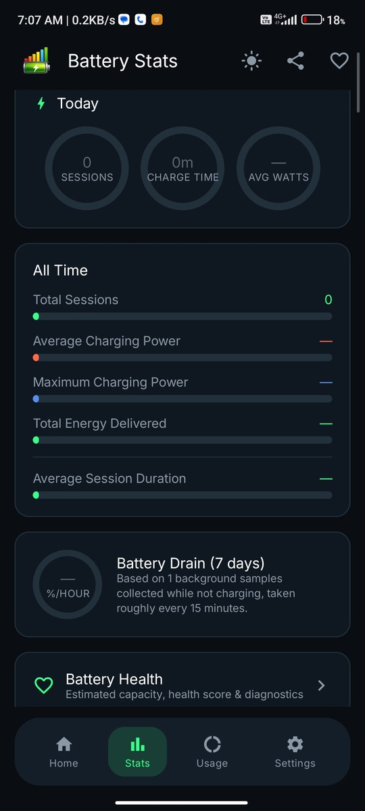 |

</details>


## ✨ Features

<div align="center">
</div>

### Live data

- **Live Monitor** with five switchable metrics: wattage, current, voltage, battery % and temperature
- Ring gauge, trend graph with min/max, rising/falling indicator, status and health badges
- **Home dashboard** with charging state, battery level, "charged N times today", power gauges and mAh charged

<div align="center">
<br/><sub>Illustrative animation of the live gauges.</sub>
</div>

### Charging intelligence

- **Charging speed class**: `FAST`, `NORMAL`, `SLOW` or `TRICKLE`, judged against what your device reports as its maximum when available
- **Time remaining** until full, estimated from recent charging samples
- **Speed Test**: pick a duration (or enter custom minutes) and get a report with percent gained, average and maximum watts
- **Charger analysis** based on the plug type and values Android exposes

### History and analysis

- **Session history**: every charge is stored locally, with per-sample detail
- **Compare two sessions** side by side
- **Statistics**: today and all-time sessions, charge time, average and maximum charging power, total energy delivered, average session duration
- **Battery drain** in %/hour from background samples taken roughly every 15 minutes while unplugged

### Battery health and checkup

- **Battery Health** with an estimated capacity, health score and diagnostics (fields a device does not expose are shown as not available instead of guessed)
- **Battery Checkup**: a six-step run that checks battery state, health flag, chemistry, power-saver mode, screen brightness and more, then lists findings by severity

### Usage and limits

- Screen time, apps used and unlock count for today or previous days
- Per-app usage with history and **daily limits** per app

### Always-on tools

- **Foreground monitoring service** that keeps sessions recording when the app is closed
- **Alerts** for high temperature, critically low battery and slow charging
- **Stop-charging reminder** at a level you choose (Android does not let apps stop charging, so it reminds you to unplug)
- **Charging Display**: a full-screen animated readout on the lock screen when you plug in
- **Four home-screen widgets** built with Glance: Charge Meter, Time Remaining, Compact Stats and Usage

### Export and personalization

- **CSV** export of session summaries and per-session samples
- **PDF** reports for a single session, the live status, or full history
- **SVG** export of the live status
- Dark, light or system theme, optional Material You dynamic colors


## 🧠 How it works

Every number comes from an Android API call. Where a device does not expose a value, such as cycle count below Android 14 or design capacity on most phones, the app says so rather than inventing a figure.

**Charging speed classes**

| Class | When the device reports its max charging power | Otherwise (absolute watts) |
|---|---|---|
| `TRICKLE` | below 2.5 W | below 2.5 W |
| `SLOW` | under 25% of device max | 2.5 W to under 7.5 W |
| `NORMAL` | 25% to under 60% of device max | 7.5 W to under 15 W |
| `FAST` | 60% or more of device max | 15 W and above |

**Data flow**

1. `BatteryDataSource` reads `BatteryManager` properties and the battery broadcast into a `BatterySnapshot`.
2. Pure functions in `domain/usecase` compute power, speed class, time estimates, capacity and health scores.
3. Repositories persist sessions and samples in Room, and settings in DataStore.
4. ViewModels expose state to Compose screens, widgets and exporters.


## 🏗 Architecture

<div align="center">
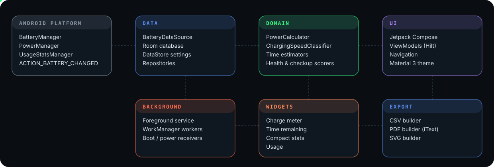
</div>

Single-module app, split into layers: **UI → domain → data**. Screens talk to ViewModels, ViewModels use repositories, repositories use Room, DataStore and Android's `BatteryManager`.

<details>
<summary><b>Tech stack</b></summary>

- **Language / build:** Kotlin 2.0.21, Android Gradle Plugin 8.6.1, KSP
- **UI:** Jetpack Compose (BOM 2024.10.01), Material 3, Navigation Compose
- **DI:** Hilt 2.52
- **Storage:** Room 2.6.1, DataStore Preferences 1.1.1
- **Background work:** WorkManager 2.10.0
- **Widgets:** Glance 1.1.1
- **Reports:** iText 7 Core 8.0.5
- **Fonts:** JetBrains Mono and Inter (downloaded at build time)

</details>


## 📥 Download

<div align="center">

[](../../releases/latest/download/batterystats.apk)

<sub>Android 8.0 or newer · signed release build · <a href="../../releases">all versions</a></sub>

</div>

1. Tap the button above, or open the **[Releases page](../../releases/latest)** and download `batterystats.apk`.
2. Open the file on your phone. If Android asks, allow *Install unknown apps* for your browser or file manager.
3. Open the app and follow the onboarding. Usage stats need *Usage access*, which you grant yourself in system settings.

> [!NOTE]
> Because the app is installed from a file and not from an app store, Android or Play Protect may show an "unknown app" notice. That is normal for any APK installed this way. Check the file with the steps below if you want to be sure.


## 🔎 Verify it yourself

Every claim above can be checked on your own phone or computer.

<details open>
<summary><b>1. The airplane-mode test</b> &nbsp;·&nbsp; 30 seconds</summary>

<br/>

Turn on airplane mode and switch Wi-Fi off. Open Battery Stats. The Live Monitor, Home, History, Checkup, exports and widgets all keep working.

</details>

<details>
<summary><b>2. The data-usage test</b> &nbsp;·&nbsp; 1 minute</summary>

<br/>

Open your phone's data-usage screen (usually *Settings → Network & internet → Data usage*, the name varies by phone) and find **Battery Stats**. After days of use it should show **0 B**.

</details>

<details>
<summary><b>3. The permission test</b> &nbsp;·&nbsp; needs a computer</summary>

<br/>

With Android SDK build-tools installed, run:

```bash
aapt2 dump permissions batterystats.apk
```

The list matches [`docs/PERMISSIONS.md`](docs/PERMISSIONS.md), and `android.permission.INTERNET` is **not** in it.

</details>

<details>
<summary><b>4. The firewall test</b> &nbsp;·&nbsp; optional</summary>

<br/>

Install any on-device firewall app and watch Battery Stats. An app without the `INTERNET` permission cannot open connections, so it never appears in the traffic log.

</details>

<details>
<summary><b>5. The checksum test</b> &nbsp;·&nbsp; confirms your download is intact</summary>

<br/>

Download `SHA256SUMS.txt` from the same release, put it next to the APK, and run this in Termux or any terminal:

```bash
sha256sum -c SHA256SUMS.txt --ignore-missing
```

You should see `OK` next to the APK you downloaded.

</details>


## 🔐 Privacy and permissions

The app has **no `INTERNET` permission**, so your data cannot leave the device. It asks for:

| Permission | Why |
|---|---|
| 🔔 Notifications | Charging alerts and the monitor notification |
| ⚙️ Foreground service | Keeps the Always-On Charging Monitor running |
| 🔁 Boot completed | Restarts monitoring after a reboot |
| 🔋 Ignore battery optimizations *(optional)* | Stops Android from killing the monitor |
| 📊 Usage access | Per-app screen time, granted by you in system settings |

Details: [`docs/PERMISSIONS.md`](docs/PERMISSIONS.md) and [`PRIVACY.md`](PRIVACY.md).


## 📚 Documentation

| | | |
|:---|:---|:---|
| 📖 [**Features**](docs/FEATURES.md)<br/><sub>Every screen explained</sub> | 🏗 [**Architecture**](docs/ARCHITECTURE.md)<br/><sub>How the app is built</sub> | ❓ [**FAQ**](docs/FAQ.md)<br/><sub>Quick answers</sub> |
| 🔑 [**Permissions**](docs/PERMISSIONS.md)<br/><sub>What and why</sub> | 🛡 [**Privacy**](PRIVACY.md)<br/><sub>Where your data lives</sub> | 📝 [**Changelog**](CHANGELOG.md)<br/><sub>Release history</sub> |
| 🔒 [**Security**](SECURITY.md)<br/><sub>Report a problem</sub> | 💬 [**Feedback**](CONTRIBUTING.md)<br/><sub>Bugs and ideas</sub> | 📜 [**Notices**](NOTICE.md)<br/><sub>Third-party parts</sub> |


## ⚠️ Copyright and usage notice

© 2026 Yash. All rights reserved.

The app's source code is private. The app, its design, artwork and documentation may not be copied, rebranded, republished or redistributed. Please download it only from the Releases page of this repository. Full terms are in [`LICENSE`](LICENSE). If you want to use any part, please ask first.

## 📬 Contact

Built by **Yash** · [yash92726@gmail.com](mailto:yash92726@gmail.com)

<div align="center">
<br/>

</div>
