<a href="../README.md">Home</a> &nbsp;·&nbsp; <a href="../docs/FEATURES.md">Features</a> &nbsp;·&nbsp; <a href="../docs/FAQ.md">FAQ</a> &nbsp;·&nbsp; <a href="../docs/PERMISSIONS.md">Permissions</a> &nbsp;·&nbsp; <a href="../PRIVACY.md">Privacy</a> &nbsp;·&nbsp; <a href="../docs/ARCHITECTURE.md">Architecture</a> &nbsp;·&nbsp; <a href="../CHANGELOG.md">Changelog</a> &nbsp;·&nbsp; <a href="../SECURITY.md">Security</a>

Battery Stats is a single-module Android app (`:app`) organized in layers. Dependencies point downward: UI depends on domain and data, domain depends on nothing Android-specific beyond model types, and data talks to the platform.

## Layers

### `data/`

| Package | Responsibility |
|---|---|
| `battery` | `BatteryDataSource` reads `BatteryManager` properties and the sticky battery broadcast into a `BatterySnapshot`. `CurrentSignNormalizer` handles devices that report charging current with opposite signs. `ChargingPollScheduler` holds the polling intervals: 2 s with the app in the foreground, 15 s in the background service, 1 s during a speed test, and 15 minutes for the drain worker. |
| `local` | Room database (`ChargeMeterDatabase`, DAOs, entities for sessions, samples and drain samples) and `SettingsDataStore` for preferences. |
| `repository` | `BatteryRepository` and `ChargingSessionRepository` combine data sources for the rest of the app. |
| `usage` | `UsageStatsRepository`, `AppUsageInfo` and `AppLimitsDataStore` for screen time and per-app limits. |
| `checkup` | `DeviceDiagnosticsRepository` gathers device state for the checkup. |

### `domain/`

`model/BatterySnapshot` holds one reading. Values a device may not expose are wrapped in `AvailableOr<T>`, so the UI must handle the "not available" case explicitly.

`usecase/` contains the calculations, written as small objects and classes with no UI dependencies:

| Class | Purpose |
|---|---|
| `PowerCalculator` | Battery input power from voltage and current |
| `ChargingSpeedClassifier` | `FAST` / `NORMAL` / `SLOW` / `TRICKLE` |
| `ChargeTimeEstimator`, `DischargeTimeEstimator` | Time until full or empty |
| `DrainRateCalculator` | Percent per hour while unplugged |
| `BatteryCapacityEstimator` | Implied full capacity and fade |
| `BatteryHealthScorer`, `BatteryCheckupScorer` | Health score and checkup findings |
| `ChargerAnalyzer` | Plug type and charger analysis |
| `SessionEnergyIntegrator` | Energy delivered over a session |
| `PowerTerminology` | Shared wording for disclaimers |

### `service/` and `util/`

- `ChargingMonitorService` is a foreground service of type `dataSync`
- `PowerConnectionReceiver` reacts to plug and unplug
- `BootCompletedReceiver` restarts monitoring after reboot
- `ChargeMeterNotificationManager` owns notification channels and alerts
- `DrainMonitorWorker`, `UsageWidgetUpdateWorker` and their schedulers run on WorkManager

### `widget/`

Four `GlanceAppWidget` implementations with matching receivers and preview drawables.

### `export/`

`CsvExportBuilder`, `PdfExportBuilder` (iText 7) and `SvgExportBuilder` write files to the app's exports directory and share them through a `FileProvider`.

### `ui/`

- `theme`: colors, typography and the Material 3 theme
- `navigation`: `ChargeMeterNavHost`, destinations and top bar actions
- `components`: reusable gauges and cards such as `RingMeter`, `NeedleGauge`, `WattMeterGauge`, `SparklineGraph`, `CapsuleMeterRow` and `InstrumentCard`
- `screens`: one package per screen, each with a Compose screen and a `ViewModel`

### `di/`

`DatabaseModule` provides the Room database and DAOs to Hilt.

## Data flow

1. A snapshot is read from `BatteryDataSource`.
2. Use cases turn it into watts, a speed class, estimates and scores.
3. While charging, the monitor stores samples in Room under a session.
4. ViewModels collect flows from repositories and expose UI state.
5. Compose screens, widgets and exporters render that state.

## Design rules

- No invented numbers. If Android does not report a value, show "not available".
- Shared disclaimer wording lives in `PowerTerminology`.
- Calculations stay in `domain/usecase` as pure, unit-testable code.
- No network access: the manifest has no `INTERNET` permission.

