<a href="../README.md">Home</a> &nbsp;·&nbsp; <a href="../docs/FEATURES.md">Features</a> &nbsp;·&nbsp; <a href="../docs/FAQ.md">FAQ</a> &nbsp;·&nbsp; <a href="../docs/PERMISSIONS.md">Permissions</a> &nbsp;·&nbsp; <a href="../PRIVACY.md">Privacy</a> &nbsp;·&nbsp; <a href="../docs/ARCHITECTURE.md">Architecture</a> &nbsp;·&nbsp; <a href="../CHANGELOG.md">Changelog</a> &nbsp;·&nbsp; <a href="../SECURITY.md">Security</a>

> [!TIP]
> Tap a question to open the answer.

<b>Why is the wattage different from my charger's label?</b>

The app shows power flowing into the battery (voltage multiplied by current). That is lower than what the charger delivers at the wall, and no Android phone can measure the wall-side figure.

<b>Why does a value say "Not available on this device"?</b>

Android only exposes some fields on some devices and versions. Cycle count needs Android 14 or newer, and most phones do not report design capacity. The app shows that plainly instead of guessing.

<b>Why is my charging speed "TRICKLE"?</b>

Power below 2.5 W is always classed as trickle. Common causes are a nearly full battery, a weak charger or cable, or a phone that is using a lot of power while the screen is on.

<b>Can the app stop charging at 80%?</b>

No. Android does not allow apps to stop charging. The stop-charging reminder alerts you to unplug at the level you choose.

<b>The Usage screen is empty.</b>

Grant *Usage access* to the app in system settings. See [`PERMISSIONS.md`](PERMISSIONS.md).

<b>Statistics say 0 sessions.</b>

Sessions are recorded while charging with monitoring active. Turn on *Auto-start monitoring on charge* in Settings and plug in your charger.

<b>Why does the app show a notification?</b>

The Always-On Charging Monitor runs as a foreground service, and Android requires a visible notification for it. Turn it off in Settings if you do not want it.

<b>Does it work on an emulator?</b>

It installs, but emulators simulate a static battery, so numbers will not be meaningful. Use a physical phone.

<b>Does the app send my data anywhere?</b>

No. It has no internet permission. See [`PRIVACY.md`](../PRIVACY.md).

<b>Can I reuse the code or design?</b>

No. All rights are reserved. See [`LICENSE`](../LICENSE).

