<a href="../README.md">Home</a> &nbsp;·&nbsp; <a href="../docs/FEATURES.md">Features</a> &nbsp;·&nbsp; <a href="../docs/FAQ.md">FAQ</a> &nbsp;·&nbsp; <a href="../docs/PERMISSIONS.md">Permissions</a> &nbsp;·&nbsp; <a href="../PRIVACY.md">Privacy</a> &nbsp;·&nbsp; <a href="../docs/ARCHITECTURE.md">Architecture</a> &nbsp;·&nbsp; <a href="../CHANGELOG.md">Changelog</a> &nbsp;·&nbsp; <a href="../SECURITY.md">Security</a>

A screen-by-screen guide to what Battery Stats does. The bottom navigation has four tabs: **Home**, **Stats**, **Usage** and **Settings**. Other screens open from those.

## Home

- Charging state badge, battery level and how many times the phone was charged today
- Charging speed class (`FAST`, `NORMAL`, `SLOW`, `TRICKLE`) with the current wattage and a small trend line
- Time remaining until full, with a trend line
- Gauges for watts and charged mAh, plus voltage, current and temperature

## Live Monitor

- Five switchable metrics: wattage, current, voltage, battery % and temperature
- Large ring gauge with a rising or falling indicator
- Trend graph with minimum and maximum values
- Live readings for voltage, current and temperature, with status and health badges

## Statistics

- **Today**: sessions, charge time and average watts
- **All time**: total sessions, average and maximum charging power, total energy delivered, average session duration
- **Battery drain (7 days)**: percent per hour, from background samples taken roughly every 15 minutes while unplugged
- Entry point to Battery Health

## Battery Health

- Estimated capacity, health score and diagnostics
- Values the device does not report are shown as not available, not guessed

## Battery Checkup

A six-step diagnostic that shows its progress as it runs: it connects to the battery service, reads level and charging status, confirms the battery is present, reads the health flag and chemistry, checks power-saver mode and screen brightness, and then lists findings by severity (good, info, warning).

## Usage

- Total screen time with a timeline for the day, apps used and unlock count
- Day navigation to look at previous days
- Per-app list; tap an app for its usage history

### App detail and limits

- Usage history for the selected app
- Set, edit or remove a **daily limit** in minutes per day

## History

- List of every recorded charging session, with delete and "clear all"
- **Session detail** with recorded samples
- **Compare sessions**: pick session A and session B and see them side by side
- **Export** the history as CSV or PDF

## Speed Test

- Choose a duration (default 5 minutes) or enter custom minutes
- Live elapsed time and power while it runs; cancel at any time
- Report with percent gained, average power and maximum power
- Needs the phone to be charging when you start

## Settings

- **Theme**: dark, light or system; optional Material You dynamic color
- **Alerts**: high temperature, critical low battery, slow-charging threshold
- **Stop-charging reminder**: reminds you to unplug at a level you pick (Android does not let apps stop charging)
- **Monitoring**: always-on charging monitor, auto-start on charge, screen-on charging statistics
- **Charging Display**: full-screen animated readout on the lock screen when you plug in
- **Background**: shortcut to allow the app to run in the background
- About and Privacy Policy screens

## Widgets

Four Glance home-screen widgets: **Charge Meter**, **Time Remaining**, **Compact Stats** and **Usage**.

## Export formats

| Format | Content |
|---|---|
| CSV | Sessions summary; samples for one session |
| PDF | Single session report; live status report; full history report |
| SVG | Live status graphic |

All exports are created locally and shared through the Android share sheet.

